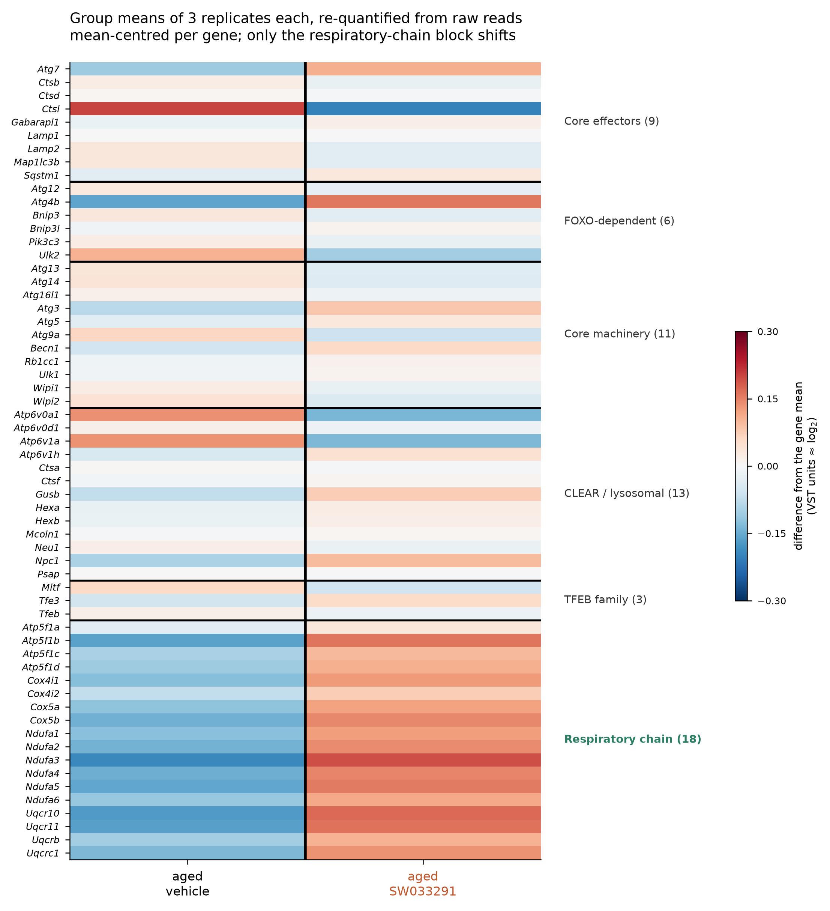

# Does 15-PGDH inhibition work through autophagy?

A reanalysis of **GSE149924** — mouse quadriceps from aged mice given the 15-PGDH inhibitor SW033291 for
a month, alongside aged and young vehicle controls. From Palla *et al.*, *Science* 2021,
[doi:10.1126/science.abc8059](https://doi.org/10.1126/science.abc8059).

The paper reports that blocking 15-PGDH rejuvenates aged muscle, and attributes part of the benefit to
restored autophagy. This repository asks a narrow question of the deposited data: **is that autophagy
effect visible in gene expression?**

## The short answer

No — and the interesting part is that this is a real answer rather than a shrug.

Muscle from drug-treated aged mice looks, in its autophagy genes, exactly like muscle from untreated aged
mice. Not subtly different, not trending: the autophagy machinery sits at the dead centre of the
transcriptome-wide distribution. The genes that build autophagosomes, the cathepsins and v-ATPase
subunits that acidify lysosomes, the TFEB transcription factors that are supposed to switch the
programme on, the FOXO-dependent arm, the mitophagy receptors — none of them move.



The same six mice, quantified from raw sequencing reads, show a large and unambiguous increase in
respiratory-chain genes. That block of the heatmap is red on the right and blue on the left; everything
above it is white. Both halves of that picture matter. The red block is the paper's own mitochondrial
finding reproducing cleanly, and it is what licenses reading the white blocks as a measurement rather
than as missing data. The experiment can see a coordinated, modest, biologically real shift when one is
there. For autophagy, there isn't one.

## What this means

**The drug almost certainly does something to autophagy. It just isn't doing it through transcription.**

Autophagy is overwhelmingly controlled after the gene is transcribed — by phosphorylation of ULK1 and
the mTORC1 complex, by lipidation of LC3, by assembly and trafficking of existing protein. A cell can
double its autophagic flux within minutes without transcribing a single new *Atg* gene. So a flat
transcriptome is not evidence against the paper's flux measurement; it is evidence about *mechanism*.
If PGE2 signalling raises autophagy in aged muscle, it is acting on protein that is already there.

That reframes what the autophagy claim rests on, and what would be needed to nail it down. The relevant
experiments are protein-level and kinetic — LC3-II and p62 with and without a lysosomal block, ideally
with a phospho-ULK1 or phospho-mTOR readout — not deeper sequencing.

**The transcriptional story that does hold up is a different one.** What the drug visibly does to the
aged muscle transcriptome is raise the respiratory chain and push back a set of genes associated with
denervation and neuromuscular-junction remodelling. The second of those is not autophagy, and it fits
the broader pattern that aged-elevated genes are returned toward their young levels. If there is a
transcriptional mechanism to chase here, that is where it is.

**A useful negative.** We checked the obvious ways a p62 blot can mislead — more p62 being made, or an
oxidative-stress response driving it — and found no sign of either. So the reanalysis does not undermine
the flux result; it narrows the space of explanations for it.

## If you are reusing this dataset

Two things cost us time and will cost you time.

**The deposited TPM matrix is broken.** Its gene names do not line up with its expression values —
myoglobin appears nearly absent from skeletal muscle, which is impossible. Anyone computing on that file
is computing on noise. The two deposited DESeq2 tables are sound, and our own re-quantification from raw
reads agrees with them closely, so this looks specific to that one file. Don't use it.

**The drug comparison is the thinnest part of the experiment.** Both arms of the SW-versus-vehicle
comparison were sequenced about four times less deeply than the young-versus-aged arm. That is why
low-abundance genes — immune markers in particular — cannot be read confidently in the drug contrast,
and it is worth knowing before designing an analysis that depends on them.

## How far the evidence goes

This is a reanalysis of three mice per group. It can say that a coordinated transcriptional autophagy
response is absent at a scale the experiment would have detected. It cannot say autophagy is unchanged —
the transcriptome does not measure flux, and no amount of sequencing would make it do so.

Two further limits are worth stating plainly. The aged-versus-young comparison exists here only in the
form the authors deposited, filtered to the genes they called significant, so questions about how
autophagy behaves with age are answered weakly. And the smallest gene sets — three TFEB genes, five
fission genes — are underpowered on their own; they are reported, but little weight rests on them.

One earlier result of ours did not survive its own robustness check and has been **retracted**: an
apparent coordinated decline in autophagy *regulatory* genes weakened substantially when we re-quantified
from raw reads and no longer stands. It is documented in the report rather than quietly deleted.

## What is here

| | |
|---|---|
| `docs/REPORT.md` | the full argument, with every statistic, test and caveat |
| `notebooks/01_reanalysis.ipynb` | all code — Part 1 on the deposited tables, Part 2 on the re-quantification |
| `figures/` | 15 figures |
| `results/tables/` | every number behind them |
| `data/` | the deposited inputs and the gene sets used |

Gene sets are custom and hypothesis-specific rather than stock GO terms, because the GO "autophagy"
category mixes the FOXO-driven, TFEB-driven and constitutive genes whose separation is the whole point.
Claims are made at the level of gene sets, not individual genes: with three mice per group, single-gene
results in this dataset are not stable enough to build an argument on.

## Reproducing

```bash
conda env create -f environment.yml && conda activate gse149924-reanalysis
tar -xzf results/quant/salmon_quant_batch2.tar.gz -C results/quant
jupyter lab notebooks/01_reanalysis.ipynb
```

Raw FASTQs (PRJNA630522, 15.5 GB) are not redistributed. The ENA mirror silently serves truncated
files — verify each download with `gunzip -t` rather than trusting the exit code.

## Citing

See `CITATION.cff`, and please cite the original study, whose authors deposited the data that made this
possible.
