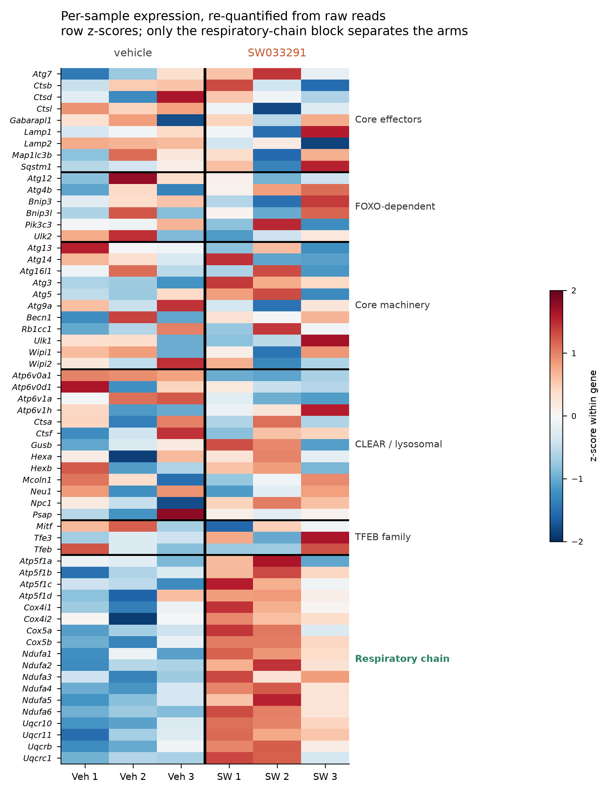
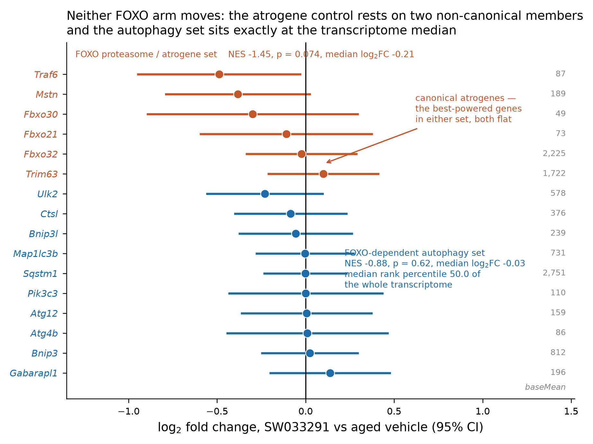
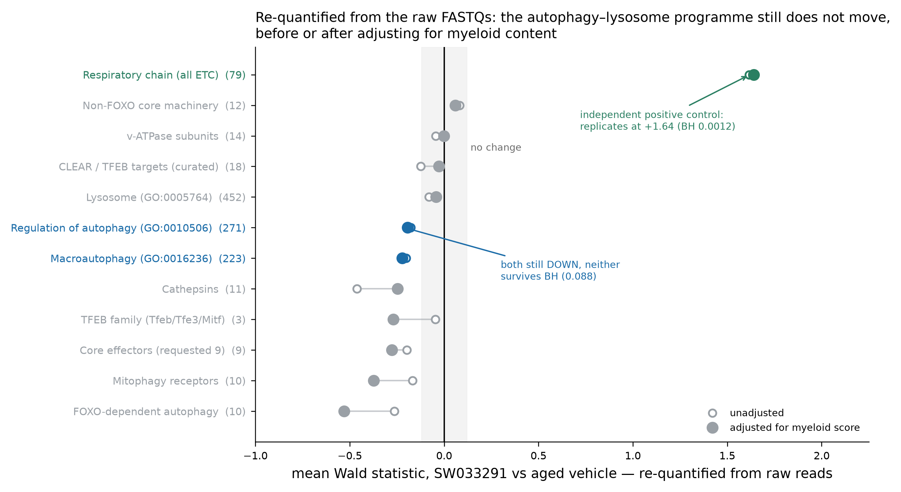
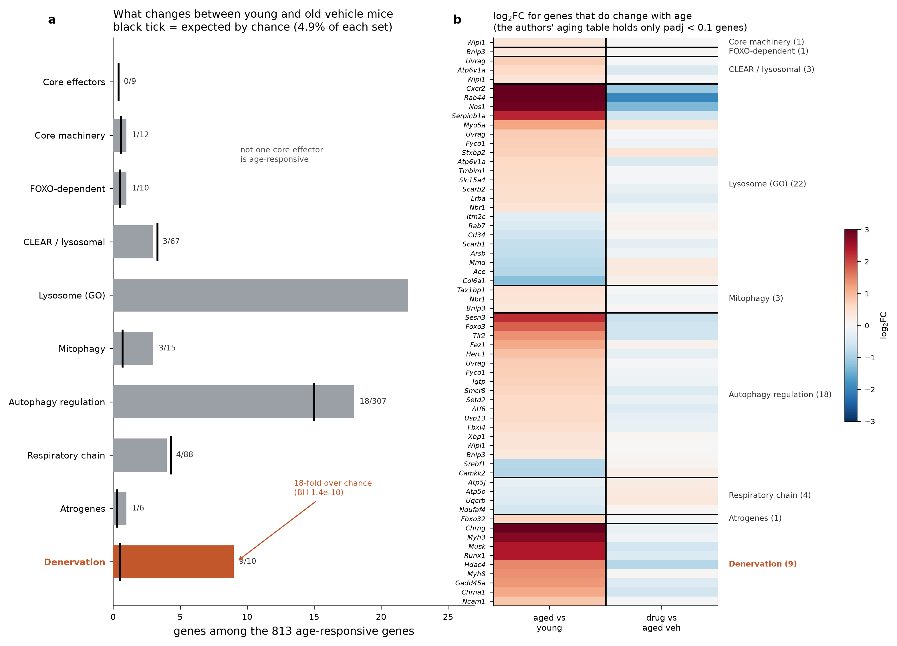

# Does 15-PGDH inhibition increase autophagy in aged muscle?

A targeted reanalysis of **GSE149924** (mouse quadriceps, aged ± the 15-PGDH inhibitor SW033291 for one
month, n=3 per arm) from Palla *et al.*, *Science* 2021, [doi:10.1126/science.abc8059](https://doi.org/10.1126/science.abc8059).

## Answer: no — the transcriptional evidence does not support it

Every autophagy-specific gene set tested is flat. The FOXO-dependent autophagy set sits at the **50.0th
rank percentile** of the transcriptome — the exact median. CLEAR/TFEB targets, non-FOXO core machinery,
the TFEB family, cathepsins, v-ATPase subunits and mitophagy receptors are all flat as well. This holds
on the authors' deposited statistics **and** on an independent re-quantification from the raw FASTQs,
before and after adjusting for myeloid cell content.

The result is interpretable rather than merely negative because the same comparison carries a working
internal positive control: 96 electron-transport-chain genes rise together (median +0.247 log2FC,
96% up, p = 8.5e-40), reproducing the paper's own Fig. 7A. The measurement resolves coordinated
low-amplitude shifts; the autophagy sets simply do not show one.

**This is positive evidence for a post-translational mechanism.** If 15-PGDH inhibition raises autophagic
flux, it does not do so by changing autophagy gene transcription.



*Only the respiratory-chain block separates the two arms (mean z −0.75 vehicle vs +0.75 drug); the
autophagy blocks are indistinguishable (+0.03 vs −0.03).*

## The decisive comparison



The FOXO-dependent autophagy set is centred on zero. The atrogene arm — intended as a positive control
reproducing the paper's Fig. 6D — fails: the enrichment rests on *Traf6* and *Mstn*, while the two
canonical atrogenes *Fbxo32* and *Trim63*, the best-powered genes in either set (baseMean 2,225 and
1,722, lfcSE 0.161), do not move. That control was never derivable from this deposit: Fig. 6D is RT-qPCR
and Fig. 6E a separate shRNA experiment, so neither can validate the RNA-seq contrast.

## Re-quantified, independent of the authors' pipeline



All six batch-2 libraries (the entire drug contrast) were re-quantified with salmon against Ensembl
GRCm39 r112 and tested with DESeq2. Fold changes agree with the deposited table at Spearman 0.783, while
resolving 16 genes at FDR < 0.05 against the deposit's 1. A per-sample myeloid score — computable only
from these counts — differs between arms by −0.347 (p = 0.60), and regressing it out leaves every
autophagy set flat while the respiratory chain holds at +1.641.

## Young versus old, and what age actually changes



The aged-vs-young comparison can only be read through the authors' deposited aging table, which is
**pre-filtered to the 813 genes at padj < 0.1** — the batch-1 libraries needed to recompute it
genome-wide were not retrieved. Within that limit the pattern is striking: **not one of the nine core
autophagy effectors is among the age-responsive genes**, and core machinery and FOXO-dependent sets
contribute one gene each, all at or below chance expectation (4.9% of any set). The denervation
programme is the opposite — 9 of 10 genes, an 18-fold enrichment (hypergeometric BH 1.4e-10).

So the autophagy machinery is not a conspicuous part of this aging signature either, which is the
backdrop against which the drug's null should be read. The right panel shows that the genes which do
rise with age — *Chrng*, *Myh3*, *Musk*, *Runx1*, *Hdac4* — are the ones the drug pushes back down.

*Caveat: absence from a filtered list means "not significant at padj < 0.1", not "unchanged". This panel
cannot distinguish the two, which is exactly what re-quantifying the batch-1 libraries would fix.*

## Findings by item

| # | item | role | verdict |
|---|---|---|---|
| 1 | Data integrity and design | gate | Partly failed — TPM matrix unusable; design confirmed, batch not dominant |
| 2 | Cell composition | gate | Failed on deposited data; **closed** by re-quantification |
| 3 | FOXO autophagy vs atrogenes | **decider** | **Weakens** — autophagy arm at the median, control fails |
| 4 | CREB/TFEB bypass | test | Neither — the route-is-live control fails |
| 5 | p62 readout confound | test | Supports weakly — the simplest confound is excluded |
| 6 | Mitochondrial dynamics | test | Weakens the fission alternative; supplies the working control |
| 7 | Denervation programme | alternative | Real but not specific |

## Two problems with the deposit

**The TPM matrix has mismatched row labels.** In `GSE149924_tpm.txt.gz` the gene-symbol column does not
correspond to the expression values: myoglobin reads 1 TPM in quadriceps while its count-based baseMean
is 6,338. Mean TPM and deposited baseMean correlate at Spearman **−0.017** across 16,677 shared symbols,
and no row offset between −3000 and +3000 recovers alignment. The two DESeq2 tables are sound; this
appears specific to the TPM file. Anyone reusing the series at gene level should not use it.

**The drug contrast runs on the shallowest libraries.** Batch-2 libraries carry 5.1–7.7 M read pairs
against 10.5–27.9 M for batch 1 — a 3.9-fold gap — and both arms of the SW-vs-vehicle comparison sit on
the low side. That is why low-abundance markers such as *Cd68* and *Ptprc* cannot settle the composition
question from the deposited tables.

## Methods in brief

Set-level statistics and effect sizes throughout; gene-wise FDR is not used as evidence, since exactly
one gene passes FDR < 0.05 genome-wide in the deposited drug contrast. Individual genes appear only as
effect sizes with confidence intervals. Gene sets are **custom and hypothesis-specific** rather than
stock GO terms, because the GO "autophagy" term mixes FOXO-dependent, TFEB-dependent and constitutive
genes and blurs the distinction under test; where GO terms are used they are labelled. Every set-level
claim is tested against an expression-matched null (background sampled within baseMean deciles), because
the sets of interest differ systematically in expression level. Multiple testing is accounted across the
32 distinct set tests (`results/tables/session_multiple_testing.csv`).

## Repository layout

```
notebooks/01_reanalysis.ipynb     all code, by item; Part 1 deposited tables, Part 2 re-quantification
docs/REPORT.md                    full written report with per-item verdicts and caveats
docs/lab_contact_draft.md         draft correspondence to the original authors
data/deposited/                   the two deposited DESeq2 tables (unmodified)
data/genesets/gene_sets.json      every gene set used
results/tables/                   all result tables (28 CSVs)
results/quant/                    salmon quantification output for the 6 batch-2 libraries
figures/                          13 figures
```

## Reproducing

```bash
conda env create -f environment.yml && conda activate gse149924-reanalysis
tar -xzf results/quant/salmon_quant_batch2.tar.gz -C results/quant   # or re-run salmon from FASTQs
jupyter lab notebooks/01_reanalysis.ipynb
```

The notebook is a faithful transcript organised by item, with cells tagged `# --- R ---` or
`# --- Python ---`; it ran across two kernels and has not been re-executed end to end as one document.
Raw FASTQs (PRJNA630522, 15.5 GB) are not redistributed here. Note that the ENA mirror silently serves
truncated files — verify every download with `gunzip -t` rather than trusting curl's exit code.

## Known limitations

- The aged-vs-young contrast was never computed genome-wide; it rests on the authors' pre-filtered
  813-gene list (padj < 0.1). Six of seven batch-1 libraries were not retrieved.
- Small sets — TFEB family (3 genes), fission (5), fusion (3), myeloid markers — remain underpowered;
  their nulls are weak and are reported as such.
- A **retracted** earlier finding: "regulation of autophagy is coordinately down" did not survive
  re-quantification (−0.301, matched p = 1e-4 → −0.177, BH 0.136). It is not a result of this work.
- The transcriptome cannot measure autophagic flux. The claim this reanalysis bears on is the
  transcriptional one; LC3-II/p62 immunoblot with a lysosomal block remains the relevant assay.

## Citation

See `CITATION.cff`. Please also cite the original study, whose authors deposited the data that made this
possible.
